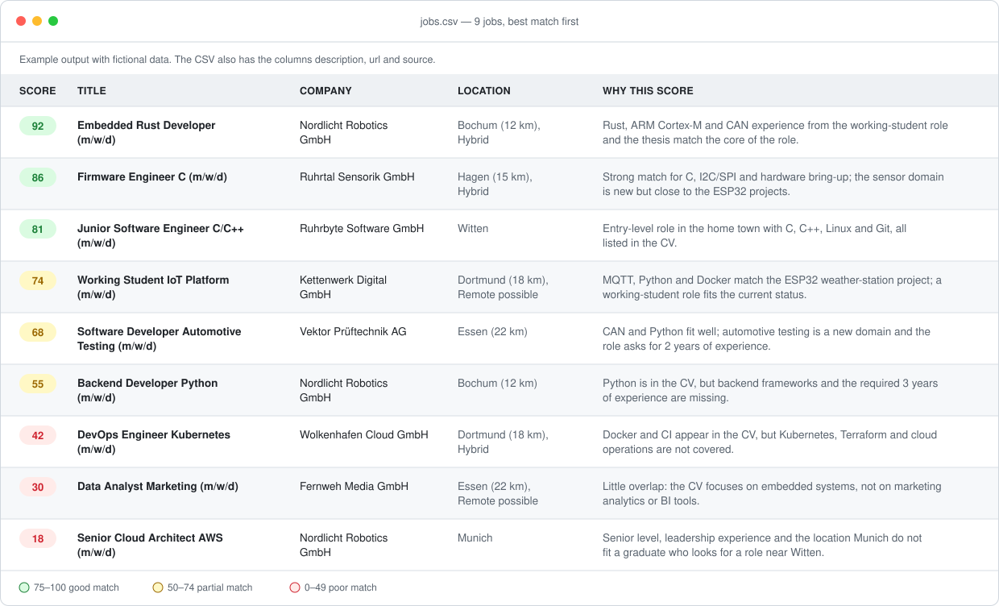
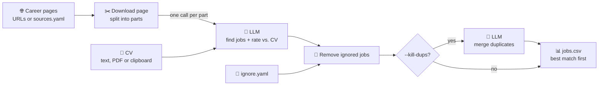

# job_radar

[](https://github.com/DseaKu/job-radar/actions/workflows/ci.yml)

Give it your CV and one or more career-page URLs.
An LLM finds the job postings, rates each job against your CV, and writes a CSV (best match first).


### The result

Each job gets a score from 0 to 100 and a short reason. Example with fictional data:



### How it works



## Quick start

Three ways to run it. All need a model: [Ollama](https://ollama.com/) on your computer
(free, no account) or an API key for Anthropic or OpenAI.

### Desktop app

A window with a CV upload, a results table and forms for all settings. No terminal, no files to edit.

1. **Install:** get the installer for your system from the
   [Releases](https://github.com/DseaKu/job-radar/releases) page.

   | System | File |
   |---|---|
   | macOS (Apple Silicon and Intel) | `.dmg`: open it, then drag Job Radar into Applications |
   | Windows | `_x64-setup.exe` or `.msi` |
   | Linux | `.deb` (Debian, Ubuntu), `.rpm` (Fedora), `.AppImage` (other, x64 only) |

   The installers have no paid signature, so the first start shows a warning. On macOS, open
   *System Settings → Privacy & Security* and click *Open Anyway*. On Windows, click
   *More info → Run anyway*.
2. **Open Settings:** select the AI provider, paste the API key (cloud models only) and add your
   search pages. *Save* writes them in the app data folder (the link at the bottom left of Settings).
3. **Drop your CV** into the window and click *Find jobs*. *Export CSV* saves the result.

To build the installer yourself, you need Rust, Node.js and (on Linux) the
[Tauri system packages](https://v2.tauri.app/start/prerequisites/#linux):

```sh
cd gui
npm install
npm run tauri build      # installer in gui/src-tauri/target/release/bundle/
```

`npm run tauri dev` starts the app without an install. It uses the settings files in the project folder,
the same files as the command line.

### With Docker (recommended)

No Rust and no other dependencies. The same on Linux, macOS and Windows.

1. **Install Docker:** [Docker Desktop](https://www.docker.com/products/docker-desktop/) on macOS and
   Windows, Docker Engine on Linux.
2. **Select a model:** install Ollama, then run `ollama pull qwen3:1.7b`. This is the default,
   so no config file is necessary. For other models, an API key or
   [extra instructions](docs/providers.md#extra-instructions), copy
   [`config.example.yaml`](config.example.yaml) to `config.yaml` and change it
   (see [Providers](docs/providers.md)).
3. **Prepare a folder** with your CV (`cv.txt` or a PDF) and your search pages in `sources.yaml`
   (template: [`sources.example.yaml`](sources.example.yaml)).
4. **Run** in this folder:

   ```sh
   docker run --rm -v "$PWD:/work" ghcr.io/dseaku/job-radar --cv cv.txt
   ```

**Done:** `jobs.csv` is in your folder. Add `-v -p` at the end to see the progress and the best jobs.
On Linux, add two more options: see [Docker](docs/docker.md).

### With Rust

1. **Install Rust** 1.88 or newer: [rustup.rs](https://rustup.rs/).
2. **Select a model:** the same as step 2 above.
3. **Get the code and add your search pages:**

   ```sh
   git clone https://github.com/DseaKu/job-radar && cd job-radar
   cp sources.example.yaml sources.yaml
   cp config.example.yaml config.yaml      # optional, see step 2
   ```

4. **Run:**

   ```sh
   cargo run --release -- --cv cv.txt
   ```

**Done:** `jobs.csv` is in the project folder.

### Try the demo

Two fictional job pages and a fictional CV, with no API key and no real job site.
Needs Rust, Python 3 and Ollama. Takes about 1 minute.

```sh
ollama pull qwen3:1.7b
demo/run.sh
```

## Options

| Command / flag | Effect |
|---|---|
| `--cv <file>` | CV as text or PDF. Without it, the CV comes from stdin (`pbpaste \| docker run -i …`). |
| `--out <file>` | Output CSV (default `jobs.csv`). |
| `--kill-dups` | One more LLM call that merges the same job from different platforms. |
| `-v`, `--verbose` | Shows the progress and the token usage. |
| `-p`, `--print-results` | Prints a table of the 10 best jobs to stdout. Without `-v` and `-p`, only warnings, errors and the result line appear. |
| `--dump <dir>` | Writes two files for each website into `<dir>`: the page text that the AI got (`<name>.page.txt`) and all jobs found on it, before the ignore list (`<name>.jobs.txt`, ignored jobs are marked). |
| `convert-cv <pdf>` | Converts a PDF CV to `cv.txt` once. |
| `page-text <url>` | Shows the page text without an LLM call. Use it to test a new source. |
| *(no URLs)* | Reads the URLs from `sources.yaml`. |

CSV columns: `match_score, title, company, location, description, match_reason, url, source`.

## Limitations

- Pages that build their job list with JavaScript return no jobs (for example LinkedIn,
  Indeed, Workday). Test a page first with `page-text`. See [Sources](docs/sources.md).
- The quality of the scores depends on the model. Small local models are fast and free, but
  they miss more jobs and do not merge duplicates reliably.

## Built with

Rust (edition 2024) with a small set of libraries:
[tokio](https://tokio.rs/) (async runtime),
[reqwest](https://docs.rs/reqwest) (HTTP),
[serde](https://serde.rs/) with `serde_json` and `serde_yaml` (API replies and config),
[csv](https://docs.rs/csv),
[pdf-extract](https://docs.rs/pdf-extract) (PDF CVs),
[dotenvy](https://docs.rs/dotenvy) (API keys from `.env`).
The HTML-to-text step has no library: it is a small parser in `src/fetch.rs`.

CI with GitHub Actions, multi-platform Docker image on `ghcr.io`, demo GIF with [VHS](https://github.com/charmbracelet/vhs).

## License

[MIT](LICENSE)

## Documentation

- [Sources](docs/sources.md): `sources.yaml`, how to add a site, pages that do not work
- [Ignore list](docs/ignore-list.md): skip jobs you already applied to
- [Providers](docs/providers.md): Ollama, Anthropic, OpenAI, output language
- [Docker](docs/docker.md): run without installing Rust, on any operating system
- [How it works](docs/how-it-works.md): page slicing, recovery of cut-off replies, duplicates
- [Testing](docs/testing.md): CI and the end-to-end demo
