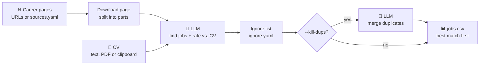

# job_radar

[](https://github.com/DseaKu/job-radar/actions/workflows/ci.yml)
[](https://github.com/DseaKu/job-radar/actions/workflows/demo.yml)

Give it your CV and one or more career-page URLs.
It downloads each page, asks an LLM to find the job postings, rates each job against your CV,
and writes everything to a CSV file (best match first).




## Try the demo (no API key)

The demo runs the full pipeline on your machine: two small fictional job pages
(`demo/site/`), a fictional CV (`demo/demo_cv.txt`) and a small local model.

```sh
ollama pull qwen3:1.7b   # about 1.4 GB
demo/run.sh              # about 1 minute
```

The same demo runs on GitHub Actions on each change: open the latest
[Demo run](https://github.com/DseaKu/job-radar/actions/workflows/demo.yml) and look at its
summary for the result table with the reason for each score.
To record the GIF again (needs `vhs` from Homebrew): `vhs demo/demo.tape`.

## Run

```sh
# CV from the clipboard (macOS)
pbpaste | cargo run -- https://example.com/careers

# CV from a file, several URLs, custom output file
cargo run -- --cv cv.md --out jobs.csv https://a.com/jobs https://b.com/careers
```

CSV columns: `match_score, title, company, location, description, match_reason, url, source`.
At the end of a run, the tool also prints a short table of the 10 best jobs.

## Duplicates

The same job can appear on several platforms. Add `--kill-dups` to remove the duplicates:

```sh
cargo run -- --cv cv.txt --kill-dups
```

This makes one more AI call. The AI groups the rows that are the same job.
For each group, the row with the highest `match_score` stays.
Its `source` column lists all sources, separated by ` | `.
If this step fails, the tool writes the CSV with the duplicates and shows a warning.

## CV as PDF

Convert the PDF to text once, check the result, then use the text file:

```sh
cargo run -- convert-cv cv.pdf          # writes cv.txt
cargo run -- --cv cv.txt https://example.com/careers
```

`--cv cv.pdf` also works directly, but then the PDF is converted on every run.
Scanned PDFs (images without a text layer) cannot be converted.

## Limits

The tool does a plain HTTP GET. Pages that build their job list with JavaScript
(for example LinkedIn, Workday, some Greenhouse/Lever embeds) return no jobs.
For those sites, use the direct job-board URL (e.g. `boards.greenhouse.io/<company>`,
`jobs.lever.co/<company>`) when one exists.

Long pages are read in parts that fit into the model's context window. Set it with
`context_length` in `config.yaml`. The tool keeps space for the CV, the prompt and `max_tokens`.
The parts overlap by 10%, so a job at a boundary is not lost. Copies from the overlap are removed.
Each part is one AI call, and each call sends the CV again. One page uses at most 20 parts.

## Sources

Without URLs on the command line, the tool reads every enabled entry in `sources.yaml`.
Git ignores this file, so your searches stay private. Create it from the template:

```sh
cp sources.example.yaml sources.yaml
cargo run -- --cv cv.txt
```

To use another file, set `JOB_RADAR_SOURCES=<path>`.

To add a site, do the search in your browser, copy the URL, and test it first
(no AI call, no cost):

```sh
cargo run -- page-text 'https://www.stepstone.de/jobs/it/in-witten?radius=25'
```

If the output shows the job titles, add the URL to `sources`.

## Ignore list

To skip jobs that you already applied to, put them in `ignore.yaml`.
Git ignores this file. Create it from the template:

```sh
cp ignore.example.yaml ignore.yaml
```

Each entry has one or more of `url`, `company` and `title`. A job is ignored if all given
fields match. `url` must be the same link. `company` and `title` match if the text is part of
the value at the start of a word (case does not count): `polizei` matches `Polizeipräsidium`,
but `its` does not match `Schwarz Digits`. The same job has a different link on each platform, so
use `company` + `title` to ignore it everywhere. The optional `note` field is for you.

Simple format: write only company names, one on each line, without the `ignore:` key.

The ignored jobs are removed after the AI read the pages, so they still cost tokens.
To use another file, set `JOB_RADAR_IGNORE=<path>`.

## Output language

Set `output_language` in `config.yaml` (default: `English`). It controls the language of
`description` and `match_reason`. Titles, companies and locations stay as on the page.

## Providers

Select the provider with `active` in `config.yaml` (`local`, `claude`, `openai`, ...).

Supported types: `ollama` (local), `anthropic`, and `openai` (any OpenAI-compatible API).

Put API tokens in a `.env` file (Git ignores it):

```sh
ANTHROPIC_API_KEY=your-key-here
OPENAI_API_KEY=your-key-here
```

## How it works

- **One interface, three APIs.** Ollama (native chat API), any OpenAI-compatible API and the
  Anthropic Messages API sit behind one `Backend`. Switch with one line in `config.yaml`.
- **Pages larger than the context window.** The page text is cut into slices that fit next to
  the CV, the prompt and `max_tokens`. The slices overlap by 10%, so a job at a boundary is
  complete in one of them, and the copies from the overlap are removed.
- **Replies that are cut off.** If a reply stops at `max_tokens`, the complete jobs before the
  cut are kept, and the slice is split in half and read again (up to 3 levels).
- **Imperfect model output.** The parser finds the JSON array inside prose or code fences,
  repairs invalid escapes that models copy from pages (`Entwickler\*in`), and moves links that
  small models put into the title to the `url` column.
- **Cost control.** Each call logs its token usage, and a run ends with the total.
  `page-text` tests a new source without an AI call, and one page uses at most 20 slices.

## Testing

- **[CI](.github/workflows/ci.yml)** (each push): `cargo fmt --check`, `cargo clippy -D warnings`
  and the unit tests. The tests need no network and no model: HTML to text, slicing, JSON
  repair, recovery of cut-off replies, the ignore list and the variables in `sources.yaml`.
- **[Demo](.github/workflows/demo.yml)** (each change of the code or the demo): an end-to-end
  run with a real model. Ollama runs as a service container on the free GitHub runner, so it
  needs no API key and costs nothing. `temperature: 0` makes the result stable. The workflow
  checks only what does not depend on the model's wording (number of jobs, ignore list,
  scores present) and writes the result table to the run summary.

The demo does not use `--kill-dups`: a model this small does not merge duplicates reliably.

## Customize

Edit the extraction prompt and the CSV columns in `src/jobs.rs`.
