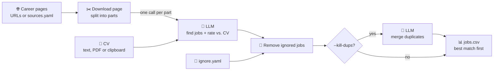

# job_radar

[](https://github.com/DseaKu/job-radar/actions/workflows/ci.yml)

Give it your CV and one or more career-page URLs.
An LLM finds the job postings, rates each job against your CV, and writes a CSV (best match first).




## Quick start

The recommended way is Docker: no Rust, no dependencies, the same on Linux, macOS and Windows.
Put your CV and your config files into one folder, then run:

```sh
docker run --rm -v "$PWD:/work" ghcr.io/dseaku/job-radar --cv cv.txt
```

The container reads `config.yaml`, `sources.yaml`, `ignore.yaml`, `.env` and your CV from the
current folder, and writes `jobs.csv` back into it. Nothing is stored in the image.
See [Docker](docs/docker.md) for Ollama, API keys and Linux (two more options).

Select the model in `config.yaml`. See [Providers](docs/providers.md).

### Without Docker

With a Rust toolchain:

```sh
cargo run --release -- --cv cv.txt
```

Try the demo with a small local model (no API key, about 1 minute):

```sh
ollama pull qwen3:1.7b
demo/run.sh
```

## Options

| Command / flag | Effect |
|---|---|
| `--cv <file>` | CV as text or PDF. Without it, the CV comes from stdin (`pbpaste \| docker run -i …`). |
| `--out <file>` | Output CSV (default `jobs.csv`). |
| `--kill-dups` | One more LLM call that merges the same job from different platforms. |
| `-v`, `--verbose` | Shows the progress, the token usage and a table of the 10 best jobs. Without it, only warnings, errors and the result line appear. |
| `convert-cv <pdf>` | Converts a PDF CV to `cv.txt` once. |
| `page-text <url>` | Shows the page text without an LLM call. Use it to test a new source. |
| *(no URLs)* | Reads the URLs from `sources.yaml`. |

CSV columns: `match_score, title, company, location, description, match_reason, url, source`.

## Limitations

- Pages that build their job list with JavaScript return no jobs (for example LinkedIn,
  Indeed, Workday). Test a page first with `page-text`. See [Sources](docs/sources.md).
- The quality of the scores depends on the model. Small local models are fast and free, but
  they miss more jobs and do not merge duplicates reliably.

## License

[MIT](LICENSE)

## Documentation

- [Sources](docs/sources.md): `sources.yaml`, how to add a site, pages that do not work
- [Ignore list](docs/ignore-list.md): skip jobs you already applied to
- [Providers](docs/providers.md): Ollama, Anthropic, OpenAI, output language
- [Docker](docs/docker.md): run without installing Rust, on any operating system
- [How it works](docs/how-it-works.md): page slicing, recovery of cut-off replies, duplicates
- [Testing](docs/testing.md): CI and the end-to-end demo
