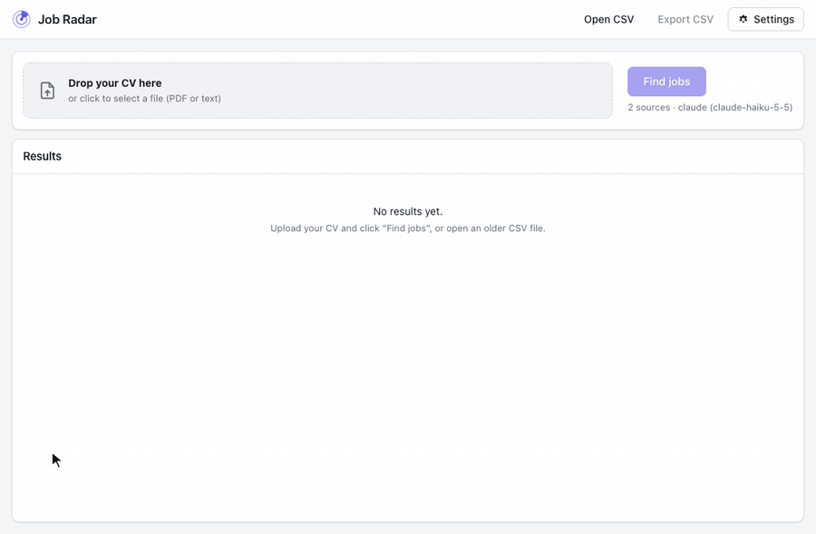
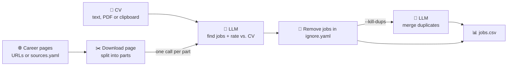
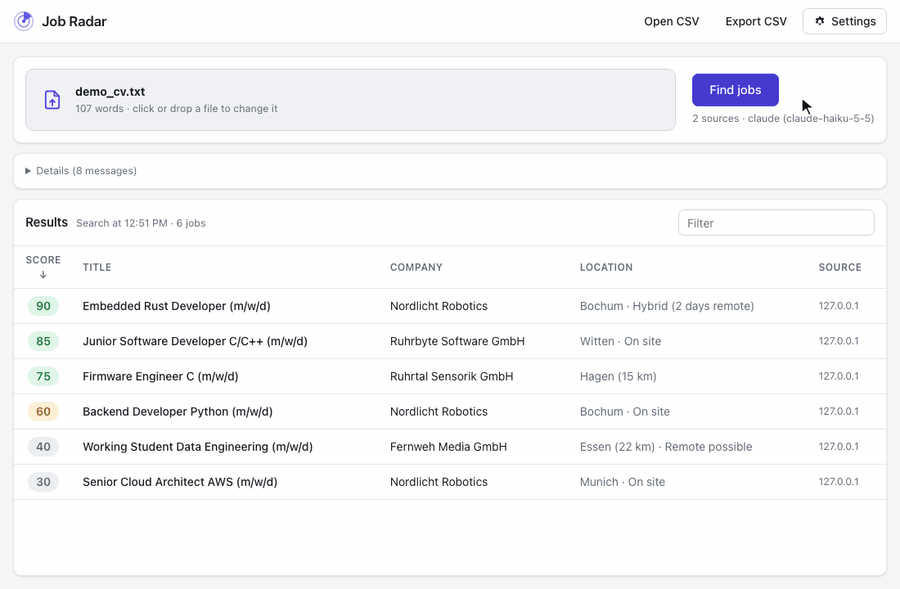

# job_radar

[](https://github.com/DseaKu/job-radar/actions/workflows/ci.yml)

Give it your CV and one or more career-page URLs. An LLM finds the job postings,
rates each job against your CV (0 to 100, with a short reason), and writes a CSV
(best match first).


<sub>The GIF uses fictional demo data. The career pages run on a local test server.</sub>

## How it works



## Cover letter drafts

For a job that you like, click _Write application_. job_radar writes a **cover letter draft**
from your CV and the job posting: a LaTeX file (and a PDF, if LaTeX is installed) in its own
folder.


<sub>Fictional demo data.</sub>

Use the draft as a template, not as a finished letter. The AI uses only facts from your CV,
but you must check the text, change it and make it your own before you send it. Your own
layout and your fixed data go into `letter.yaml`. See [Applications](docs/applications.md).

## Quick start

You need a model: [Ollama](https://ollama.com/) (free, local) or an API key for
Anthropic or OpenAI. Recommended: **Claude Haiku 5.5** (`claude-haiku-5-5`),
about $0.02 per run. The free default `qwen3:1.7b` misses more jobs and does not
merge duplicates reliably. See [Providers](docs/providers.md).

### Desktop app

Get the installer from [Releases](https://github.com/DseaKu/job-radar/releases):
`.dmg` (macOS), `_x64-setup.exe` / `.msi` (Windows), `.deb` / `.rpm` /
`.AppImage` (Linux). The installers are not signed: on macOS, use _System
Settings → Privacy & Security → Open Anyway_; on Windows, _More info → Run
anyway_.

In _Settings_, select the provider, paste the API key and add your search pages.
Then drop your CV into the window and click _Find jobs_. To write a cover letter
(LaTeX) for a job, select it and click _Write application_. To build the app
yourself: `make gui-build` (needs Rust, Node.js and on Linux the
[Tauri packages](https://v2.tauri.app/start/prerequisites/#linux)).

### Docker (recommended for the command line)

Put your CV (`cv.txt` or a PDF) and `sources.yaml` (template:
[`sources.example.yaml`](sources.example.yaml)) in a folder. For a model other
than the Ollama default, add `config.yaml` (template:
[`config.example.yaml`](config.example.yaml)). To create these files from the examples, run
`docker run --rm -v "$PWD:/work" ghcr.io/dseaku/job-radar init`. Then run in this folder:

```sh
docker run --rm -it --pull always -v "$PWD:/work" ghcr.io/dseaku/job-radar --cv cv.txt -v -p
```

The result is in `jobs.csv`. `--pull always` gets the newest image. Without it, Docker uses an old
local copy, and new options can fail with `unknown option`. With `-it`, job_radar can ask (y/N) to
create missing settings files from the examples. On Linux, see [Docker](docs/docker.md).

In a clone of this repository, `make search` runs the same command (also on Linux). See
[Make commands](#make-commands).

### Rust

Needs Rust 1.88 or newer.

```sh
git clone https://github.com/DseaKu/job-radar && cd job-radar
make init LOCAL=1     # creates sources.yaml, config.yaml, ... from the examples
make search LOCAL=1   # same as: cargo run --release -- --cv cv.txt -v -p
```

**Demo** with fictional data (needs Rust, Python 3 and Ollama, about 1 minute):
`ollama pull qwen3:1.7b && make demo`

## Make commands

In a clone of this repository, the [`Makefile`](Makefile) gives short commands. `make` shows
the list. The commands run the Docker image; add `LOCAL=1` to use the code in the folder with
cargo. `CV=<file>` sets the CV (default `cv.txt`).

| Command                       | Effect                                                              |
| ----------------------------- | ------------------------------------------------------------------- |
| `make search`                 | Finds and rates jobs (`-v -p`). More options: `ARGS="--kill-dups"`. |
| `make init`                   | Creates the missing settings files (`*.yaml`) from the examples.    |
| `make page-text URL=<url>`    | Shows the page text without an LLM call.                            |
| `make application JOB=<n>`    | Writes a cover letter for job `n` of the CSV (or a job URL).        |
| `make convert-cv PDF=<file>`  | Converts a PDF CV to `cv.txt`.                                      |
| `make test`                   | Runs the unit tests.                                                |
| `make lint` / `make fmt`      | Checks the format and runs clippy / formats the code.               |
| `make check`                  | All CI checks (`lint` and `test`).                                  |
| `make demo`                   | Runs the demo with fictional data.                                  |
| `make gui` / `make gui-build` | Starts the desktop app in development mode / builds it.             |
| `make docker-build`           | Builds the Docker image from the folder (tag `job-radar`).          |

## Options

| Command / flag          | Effect                                                                    |
| ----------------------- | ------------------------------------------------------------------------- |
| `--cv <file>`           | CV as text or PDF. Without it, the CV comes from stdin.                   |
| `--out <file>`          | Output CSV (default `jobs.csv`).                                          |
| `--kill-dups`           | One more LLM call that merges the same job from different platforms.      |
| `-v`, `--verbose`       | Shows the progress and the token usage.                                   |
| `-p`, `--print-results` | Prints the 10 best jobs.                                                  |
| `--dump <dir>`          | Writes the page text and all found jobs for each website into `<dir>`.    |
| `application <n>`       | Writes a cover letter for job `n` of the CSV (or a job URL): LaTeX + PDF. |
| `convert-cv <pdf>`      | Converts a PDF CV to `cv.txt` once.                                       |
| `page-text <url>`       | Shows the page text without an LLM call. Use it to test a new source.     |
| `init`                  | Creates the missing settings files (`*.yaml`) from the examples.          |
| _(no URLs)_             | Reads the URLs from `sources.yaml`.                                       |

CSV columns:
`match_score, title, company, location, description, match_reason, url, source`.

### Extra request fields

Some APIs need extra fields in the request body. Add them with `extra_body` in
`config.yaml` (app: _Settings → AI provider → Advanced_). Example for Leiolai:

```yaml
providers:
  leiolai:
    type: openai
    model: leiolai-1
    base_url: https://api.leiolai.com/v1
    api_key_env: LEIOLAI_API_KEY # the key itself stays in .env
    extra_body: { "mode": "private" }
    stream: true # Leiolai is slow: without a stream, Cloudflare stops long requests (HTTP 524)
```

## Limitations

- Pages that build their job list with JavaScript return no jobs (for example
  LinkedIn, Indeed, Workday). Test a page first with `page-text`.
- The quality of the scores depends on the model.

## More

- Docs: [Sources](docs/sources.md) · [Ignore list](docs/ignore-list.md) ·
  [Applications](docs/applications.md) · [Providers](docs/providers.md) ·
  [Docker](docs/docker.md) · [How it works](docs/how-it-works.md) ·
  [Testing](docs/testing.md) · [Changelog](CHANGELOG.md)
- Built with Rust (tokio, reqwest, serde, csv, pdf-extract, dotenvy) and Tauri.
  The HTML-to-text parser is in `src/fetch.rs`.
- License: [MIT](LICENSE)
