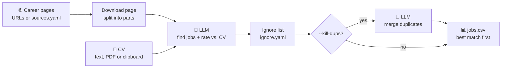

# job_radar

[](https://github.com/DseaKu/job-radar/actions/workflows/ci.yml)

Give it your CV and one or more career-page URLs.
An LLM finds the job postings, rates each job against your CV, and writes a CSV (best match first).




## Quick start

Try the demo with a small local model (no API key, about 1 minute):

```sh
ollama pull qwen3:1.7b
demo/run.sh
```

Run it on real pages:

```sh
cargo run -- --cv cv.txt --out jobs.csv https://a.com/jobs https://b.com/careers
```

Select the model in `config.yaml`. See [Providers](docs/providers.md).

Or use Docker, without installing Rust. Your config files and your CV stay in your folder:

```sh
docker run --rm -v "$PWD:/work" ghcr.io/dseaku/job-radar --cv cv.txt
```

See [Docker](docs/docker.md) (Linux needs two more options).

## Options

| Command / flag | Effect |
|---|---|
| `--cv <file>` | CV as text or PDF. Without it, the CV comes from stdin (`pbpaste \| cargo run -- …`). |
| `--out <file>` | Output CSV (default `jobs.csv`). |
| `--kill-dups` | One more LLM call that merges the same job from different platforms. |
| `convert-cv <pdf>` | Converts a PDF CV to `cv.txt` once. |
| `page-text <url>` | Shows the page text without an LLM call. Use it to test a new source. |
| *(no URLs)* | Reads the URLs from `sources.yaml`. |

CSV columns: `match_score, title, company, location, description, match_reason, url, source`.

## Documentation

- [Sources](docs/sources.md): `sources.yaml`, how to add a site, pages that do not work
- [Ignore list](docs/ignore-list.md): skip jobs you already applied to
- [Providers](docs/providers.md): Ollama, Anthropic, OpenAI, output language
- [Docker](docs/docker.md): run without installing Rust, on any operating system
- [How it works](docs/how-it-works.md): page slicing, recovery of cut-off replies, duplicates
- [Testing](docs/testing.md): CI and the end-to-end demo
